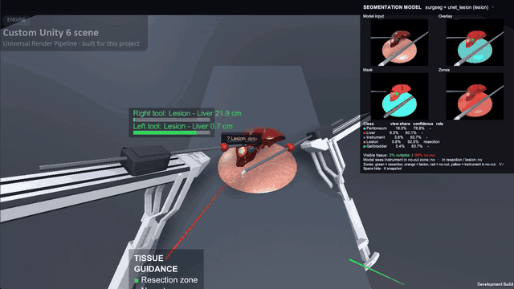
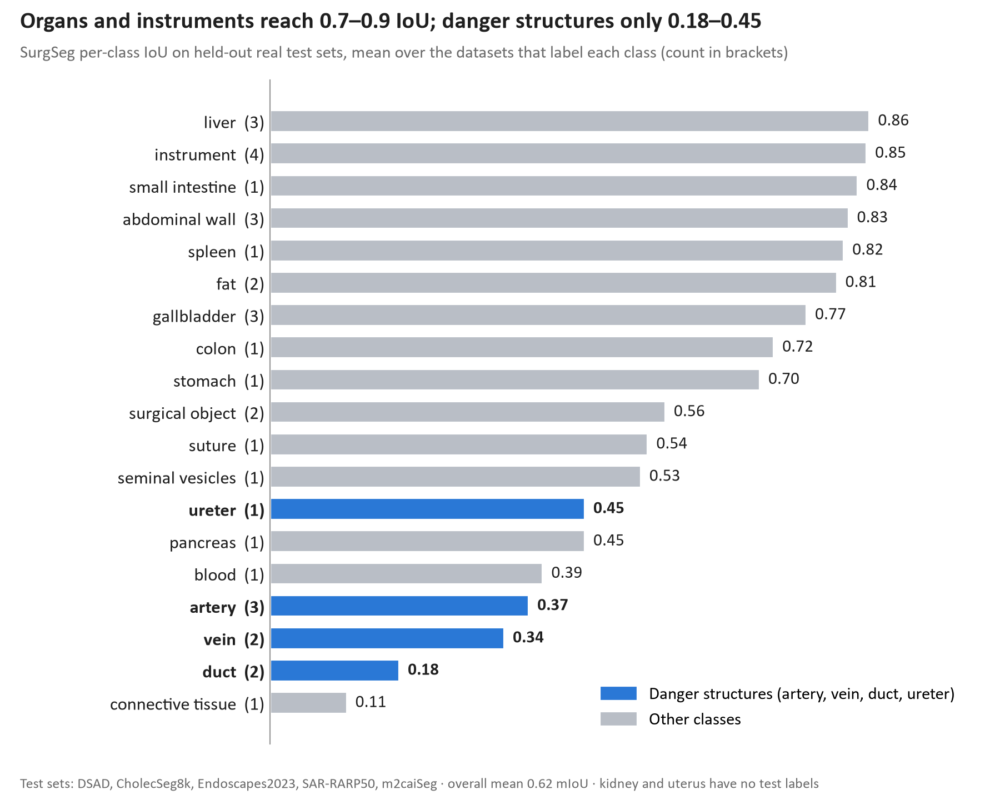

# Adaptive VR Coaching & Safety System for Robot-Assisted Surgical Training

A VR trainer for robot-assisted surgery that **knows the anatomy it is showing**. A surgical
segmentation model (**SurgSeg**) looks at every endoscope frame, finds 22 kinds of tissue and
instruments, and the system turns that into coaching: it marks the **target** tissue, marks
**danger** structures (artery, duct, vein, ureter), and warns the trainee when a robot tool tip
gets too close to danger.

**Trained model:** download `surgseg.onnx` and `surgseg.json` from the
[v1.0 release](https://github.com/murugansaravanan963-afk/vr-surgical-coaching/releases/tag/v1.0)
and put both in `models/`. The ONNX file is ~100 MB, too large to store in the repo itself.

## Demo: VR trainer walkthrough



Full-quality video (46 s, 1080p): [vr_trainer_walkthrough.mp4](docs/figures/slide4/vr_trainer_walkthrough.mp4) (GitHub can't play MP4 files in the browser, so click **View raw** / download to watch).

## System overview

The system has two parts: an **offline** part that trains the model once, and a **live** loop
that runs every frame while the trainee operates.

```mermaid
flowchart LR
    subgraph OFF["Offline: train the model (once)"]
        direction TB
        D["6 public surgical datasets<br/>DSAD, SISVSE, CholecSeg8k,<br/>Endoscapes, SAR-RARP50, m2caiSeg"]
        U["Unlabeled surgical video"]
        S["Simulator frames with exact masks<br/>(domain-randomized Unity scene)"]
        TX["One 22-class taxonomy<br/>+ partial-label loss"]
        T["Teacher: LemonFM ConvNeXt-L + UPerNet<br/>~230M params, accurate"]
        ST["Student: SurgeNetXL CaFormer-S18 + FPN<br/>~28M params, real-time"]
        X["Calibrate + export<br/>surgseg.onnx + surgseg.json"]
        D --> TX --> T
        T -->|knowledge distillation| ST
        U --> ST
        TX --> ST
        S -->|fine-tune| ST
        ST --> X
    end

    subgraph LIVE["Live loop: every frame"]
        direction TB
        VR["VR trainer (Unity)<br/>endoscope camera, da Vinci PSM tools,<br/>anatomy, Quest 3 or desktop"]
        SEG["SegEngine<br/>ONNX model: 22-class probabilities"]
        ROLE["RoleAssigner<br/>target / danger / neutral / instrument<br/>Mode 1 manual, Mode 2 procedure profile"]
        SAFE["SafetyMonitor<br/>tool-tip to danger distance,<br/>hysteresis, stale-frame check"]
        OUT["Feedback in VR<br/>world-locked overlay, HUD alert levels,<br/>labels, session logs"]
        VR -->|frame + tool-tip positions + depth| SEG --> ROLE --> SAFE --> OUT
        OUT -->|next frame| VR
    end

    X -->|deploy model| SEG
```



The live loop can run two ways: the Unity scene sends frames over **ZeroMQ** to the Python
server in this repo (`surgseg.runtime.server`), or the VR build loads `surgseg.onnx` directly
with **Unity Inference Engine** (no Python on the VR PC); `roles.py` and `safety.py` are small
enough to port to C#.

## How it works, step by step

1. **Capture.** Every time the model is free, Unity grabs the endoscope camera image, the
   tool-tip positions of both robot arms, and a depth image of the scene.
2. **Segment.** The student model labels every pixel with one of 22 classes (liver,
   gallbladder, cystic duct, artery, vein, ureter, fat, instruments, ...). Its probabilities
   are calibrated (temperature scaling), so a confidence threshold means something.
3. **Assign roles.** Classes become roles for the current task.
   - *Mode 1, manual:* the trainee or instructor points at tissue and marks it target or danger.
   - *Mode 2, automatic:* a procedure profile, e.g. [cholecystectomy](configs/roles/cholecystectomy.yaml),
     says which structures are targets and which are dangerous, optionally per surgical step.
4. **Check safety.** For each tool tip, the monitor measures the distance to the nearest danger
   region and sets an alert level: **OK**, **WARNING** (inside the warning margin) or
   **VIOLATION** (at contact distance). Hysteresis stops the alert from
   flickering, and frames that arrive too late are rejected instead of shown.
5. **Show it on the tissue.** Target and danger marks are drawn as an overlay. With
   [SurgSegWorldLock.cs](integration/unity/SurgSegWorldLock.cs) the marks are re-projected
   with depth every rendered frame, so they **stay stuck to the tissue when the trainee's head
   or the camera moves**, even though the model runs slower than the headset.
6. **Coach and log.** The HUD shows alert levels, labels and the distance to danger. The VR
   build also logs each session (alerts, distances, segmentation runs) to CSV, so the trainee
   can get feedback afterwards.

## Results

| Measurement | Result |
|---|---|
| Student model, real **test** sets (mean IoU) | **0.622** over 5 datasets: DSAD 0.670, SAR-RARP50 0.690, m2caiSeg 0.675, Endoscapes 0.569, CholecSeg8k 0.506 |
| Speed, full pipeline (model + roles + safety), laptop RTX 5060, DirectML | **25.5 ms** at 384×480, **47.6 ms** at 512×640 |
| Overlay stays on the tissue while the camera moves (overlap with true position, 3 test motions) | world-locked **0.96 / 0.99 / 0.85** vs flat screen overlay 0.21 / 0.25 / 0.48 |

Per-class accuracy on the real test sets: large organs and instruments are recognised well
(liver 0.86, instruments 0.85); thin danger structures are the hardest (artery 0.37,
vein 0.34, duct 0.18), which is the main thing to improve.



## Repository layout

```
surgseg/              model, training, evaluation, ONNX export
  datasets/           converters for each public dataset -> one format
  runtime/            live server: SegEngine, RoleAssigner, SafetyMonitor (ZeroMQ)
  tools/              data checks, benchmark, confusion matrix, demos
configs/              22-class taxonomy, training configs, procedure role profiles
scripts/linux/        environment setup, data download/preparation, training pipeline
integration/unity/    Unity client, world-lock shaders, dataset generator, anatomy meshes
docs/                 training notes, figures, demo video
tests/                unit tests
```

## 1. How the model is made accurate

| Lever | What we do | Why |
|---|---|---|
| **Surgical foundation backbones** | Teacher: **LemonFM** (ConvNeXt-L, self-supervised on 938 h of surgical video, Apache-2.0). Student: **SurgeNetXL** (CaFormer-S18, 4.7 M surgical frames). | Encoders pretrained on surgery beat ImageNet ones on surgical segmentation. LemonFM reports 81.3 vs 69.0 mDice over SurgeNetXL on CholecSeg8k. |
| **8 labeled datasets, 1 taxonomy** | The 5 original datasets plus **Endoscapes**, **SAR-RARP50** and **m2caiSeg**, mapped to 22 classes ([taxonomy.yaml](configs/taxonomy.yaml)) | More anatomy, more da Vinci tool appearance. Endoscapes labels the cystic **artery and duct**, the classic danger structures. |
| **Partial-label loss** | When dataset X calls a pixel "background", the model learns only "none of the classes X labels". Ambiguous labels become **groups** ("GI tract" means stomach, small intestine or colon). Non-exhaustive labels become **partial** labels. | Without this, the datasets contradict each other. Verified in [tests/test_core.py](tests/test_core.py). |
| **Unlabeled surgical video** | About 20k frames from Endoscapes and SAR-RARP50 videos (more with Cholec80, your own recordings, etc.) | The student learns from the teacher ensemble on these frames, with no labels needed. |
| **Self-training** | A 3-teacher ensemble (flip and multi-scale averaging, calibrated) completes the partial labels and pseudo-labels the unlabeled video. A round-2 teacher then trains on the result. | Completion fills in, say, liver on EndoVis18 frames, but only where the original label allows it and the ensemble is confident. |
| **Safety-focused sampling** | Frames that show artery, vein, duct, ureter or seminal vesicles are drawn 3× more often | Rare structures are the ones that matter most. |
| **EMA weights, calibration** | Weight averaging; a temperature is fitted per model and baked into the ONNX file | More stable models, and probability thresholds that mean something. |
| **Sim fine-tuning** | A few hundred frames from your simulator, with ground truth exported by the engine ([finetune_sim.yaml](configs/finetune_sim.yaml)) | Closes the gap between real video and rendered tissue, the biggest remaining risk. |

**Pipeline** ([scripts/linux/run_pipeline.sh](scripts/linux/run_pipeline.sh) runs every stage in order):
```
3 × LemonFM teachers (seeds) ─► calibrate ─► ensemble pseudo-labels + label completion (8 GPUs)
   ─► round-2 LemonFM teacher on completed data ─► calibrate
   ─► SurgeNetXL student distilled from the ensemble on labeled + unlabeled frames
   ─► evaluate, calibrate, export ONNX, benchmark   ─► (your sim frames) ─► fine-tune student
```

## 2. Data sources

| Dataset | Content | Access | Licence |
|---|---|---|---|
| DSAD | da Vinci rectal resection: 11 structures incl. ureter, vessels | Hugging Face (scripted) | CC BY 4.0 |
| SISVSE | robotic gastrectomy, real + **synthetic** | Dataset Ninja (scripted) | see source |
| CholecSeg8k | cholecystectomy, 13 classes | Kaggle (token) | CC BY-NC-SA |
| **Endoscapes2023** | cholecystectomy: cystic artery/duct, gallbladder; 58k unlabeled frames | public zip (scripted) | CC BY-NC-SA |
| **SAR-RARP50** | da Vinci Si suturing: tool parts, needle, thread, clips | figshare (scripted, 34 GB) | CC BY-NC-SA |
| **m2caiSeg** | cholecystectomy, 19 classes (small) | Hugging Face (scripted) | CC BY-NC-SA |
| EndoVis 2017/2018 | da Vinci tools / nephrectomy scene | grand-challenge.org sign-up (manual) | challenge terms |
| *optional:* AutoLaparo, Cholec80, HeiChole, SurgeNetYoutube | uterus seg / unlabeled video | request forms | NC |

Missing datasets are skipped with a warning, so you can start before EndoVis access comes through.
Unlabeled video from any source goes in with `python -m surgseg.datasets.prepare_unlabeled`.

**Licences:** most of the data and SurgeNetXL are **non-commercial**. That's fine for academic
research, but the trained weights inherit these terms. LemonFM itself is Apache-2.0.

## 3. Training on a Linux machine

Requirements: Linux, an NVIDIA GPU with a CUDA 12.x driver (training used 4× A100 80 GB;
one GPU works but is slower), Python 3.10+, and ~100 GB of free disk for data and runs.
The scripts use every GPU the machine has (limit with `CUDA_VISIBLE_DEVICES`).

```bash
git clone https://github.com/murugansaravanan963-afk/vr-surgical-coaching.git surgseg
cd surgseg
bash scripts/linux/setup_env.sh                  # once: creates .venv and installs everything
source scripts/linux/env.sh                      # in every new shell
bash scripts/linux/download_data.sh              # ~45 GB, a few hours
bash scripts/linux/prepare_data.sh               # -> data/processed + preview_*.jpg
#   LOOK AT preview_*.jpg before training: a wrong label mapping shows up immediately there.
bash scripts/linux/run_pipeline.sh 2>&1 | tee logs/pipeline.log   # teachers -> labels -> round 2 -> student -> export
```

* Data, runs and models go to `data/`, `runs/` and `models/` inside the repo. To put them on
  another disk, export `SURGSEG_DATA`, `SURGSEG_RUNS` or `SURGSEG_MODELS` before sourcing `env.sh`.
* The pipeline takes days, so run it inside `tmux` or `screen`. Logs are in `logs/`.
* Every stage is resumable. Training saves `<run>/last.pt` regularly; if anything stops,
  run the same command again and it continues. A stage counts as finished only when
  `<run>/DONE` exists (for the label stage, `processed/PSEUDO_LABELS_DONE`), so later stages
  never start on a half-trained model.
* Single steps: `bash scripts/linux/train.sh configs/<config>.yaml`,
  `bash scripts/linux/eval_export.sh runs/<run>`.
* Fewer or more teachers: `NUM_TEACHERS=1 bash scripts/linux/run_pipeline.sh` (default 2).
* The final model lands in `models/<run name>/surgseg.onnx` (+ `surgseg.json`).
* ImageNet SegFormer baselines for comparison are in `configs/baselines/`.

## 4. The two modes

| | Mode 1: MANUAL (user assigns) | Mode 2: AUTO (system assigns) |
|---|---|---|
| Who decides | Trainee or instructor in VR | Procedure profile, optionally per surgical step |
| How | Point the controller at tissue → the engine projects the hit point into the endoscope camera → `select(u, v, role, scope)` | `set_mode(auto, procedure, step)` |
| Granularity | `scope="class"`: all tissue of that class. `scope="region"`: just that blob, tracked across frames | Per class |
| Overrides | n/a | Manual picks made in AUTO override the profile |

The profiles in [configs/roles/](configs/roles/) cover cholecystectomy, nephrectomy, rectal
resection, gastrectomy and a default. Steps such as `calot_dissection` change target and danger
mid-procedure. **Have a surgeon review these profiles**; the lists are a starting point.

## 5. Putting it into a simulator

```bash
pip install -r requirements-runtime.txt           # no PyTorch on the VR PC
python -m surgseg.runtime.server --model surgseg.onnx --procedure cholecystectomy
```

* **Any engine:** ZeroMQ protocol documented in [server.py](surgseg/runtime/server.py).
  Python client: [client_example.py](surgseg/runtime/client_example.py).
* **Unity:** [SurgSegClient.cs](integration/unity/SurgSegClient.cs) (ZeroMQ client, HUD, alerts) and
  [SurgSegWorldLock.cs](integration/unity/SurgSegWorldLock.cs) (overlay that stays on the tissue).
* **Isaac Sim / ORBIT / SurRoL:** call `SegEngine`, `RoleAssigner` and `SafetyMonitor` in-process.
* **Unity Sentis / Unreal NNE:** the .onnx file is self-contained. Port `roles.py` and `safety.py`.

**Measured latency** of the SurgeNetXL student, full pipeline (model + roles + safety), on an
RTX 5060 *laptop* GPU through DirectML (FP32, no TensorRT):

| Input | ms | FPS |
|---|---|---|
| 384×480 | 25.5 | 39 |
| 512×640 | 47.6 | 21 |

Guidance does not need the headset's 90 Hz; 20–40 Hz overlays are fine. TensorRT FP16 on a
desktop VR GPU should be faster; measure it with `python -m surgseg.tools.benchmark`.

Arm-to-arm proximity does not use segmentation. Compute it from robot kinematics in the
simulator, independently.

## 6. What has been verified, and what has not

Verified locally:
- **Backbone conversions match their reference implementations.**
  - SurgeNetXL matches SurgeNet's own model code (max difference 5e-5). Its CaFormer uses
    plain ReLU where stock timm uses StarReLU. Without the patch the weights load almost
    cleanly but compute wrong features, so an unpatched model is refused.
  - LemonFM matches the authors' loader exactly (difference 0).
- All 10 dataset converters ran on mock data built from each dataset's verified layout:
  real Endoscapes and SAR-RARP50 file listings and READMEs, the m2caiSeg and DSAD parquet
  schemas, and SAR-RARP50 frame extraction from video.
- The full pipeline ran on CPU with the real backbone weights: teachers, calibration,
  sharded pseudo-labeling and merge, ensemble distillation on unlabeled frames, EMA and
  resume, ONNX export (matches PyTorch to 7e-7), and the GPU benchmark.
- 15 unit tests pass: loss maths, partial labels, label completion never contradicting
  ground truth, sampling, roles, safety, and backbone equivalence.

**Not verified:**
- EndoVis 17/18 and SISVSE layouts are still based on their documentation; the converters
  fail loudly if they differ.

This is a training aid, not a medical device.
